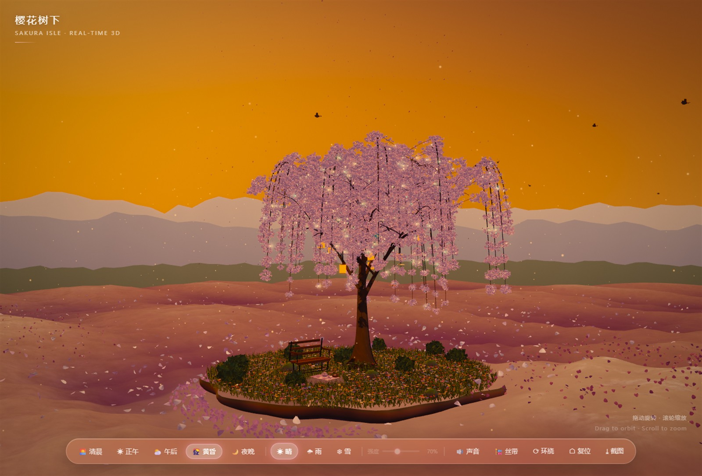

# 樱花树下 · Sakura Isle

一个纯前端、单文件离线运行的 3D 小场景：黄昏火烧云下的垂枝樱花树，长在花瓣海中的小岛上。

**在线预览**：<https://shiwoxiaobailong0828-maker.github.io/sakura-isle/>



## 特性

- **单文件离线**：`docs/index.html` 一个文件（约 1.55 MB），双击即开，无任何外部请求
- **零素材**：树、花、草、岛、石头全部程序化生成；树皮与黄昏 HDRI 贴图由 Blender 脚本烘焙后 base64 内嵌
- **5 个时段**：清晨 / 正午 / 午后 / 黄昏 / 夜晚，色调、雾、光照、泛光整套切换
- **3 种天气**：晴 / 雨 / 雪
- **统一风场**：树干、垂枝、花瓣、草地、海面共用一个风场，枝条与花刚性同动
- **生活感**：灯笼、光尘、萤火虫、鸟群、蝴蝶、野餐、长椅；点击灯笼可点亮，点树冠会摇落花瓣
- **自适应降质**：帧率低于 40fps 连续两次自动降档，保证老显卡也能跑
- **桌面端优化**：目标平台 Chrome / Edge（不做移动端适配）

## 目录结构

```
docs/index.html      构建产物（单文件，直接可运行）
src/app_part1..4.js  源码：岛与环境 / 樱花树 / 草与陈设 / 天空·后期·交互
src/shell.html       HTML 外壳
tools/build.ps1      拼接源码 + 注入 base64 贴图 → docs/index.html
tools/shot.ps1       无头 Chrome 截图
tools/serve.py       本地预览（8770）
textures/            树皮四件套与黄昏 HDRI（Blender 烘焙）
blender/             贴图生成脚本（numpy 程序化）
```

## 本地运行

直接双击 `docs/index.html` 即可；或起本地服务：

```bash
python tools/serve.py 8770
# 打开 http://127.0.0.1:8770/
```

## 重新构建

```powershell
# 拼接 src/app_part1..4.js → src/app.js
# 然后注入贴图生成 docs/index.html
powershell -ExecutionPolicy Bypass -File tools/build.ps1
```

## 技术栈

three.js r169（IIFE 全局引入，无构建工具）、手写程序化几何、自定义后期管线（亮部提取 → 两级模糊 → ACES + 饱和 + 暗角 + 抖动）。

## License

MIT
